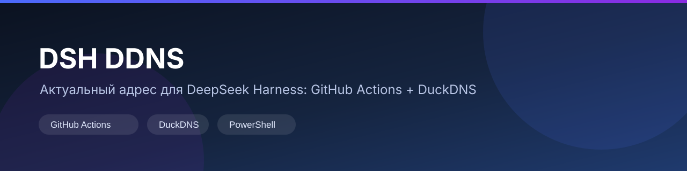

  

# dsh-ddns

**RU** · [English](#english)

> DDNS-обновлялка для DeepSeek Harness: GitHub Actions + DuckDNS следят, чтобы домен указывал на текущий публичный IP.

| 🧭 Раздел | О чём |
| --- | --- |
| [Зачем](#зачем) | Какая задача стоит перед updater'ом |
| [Как работает](#как-работает) | Шаги скрипта update-ddns.ps1 |
| [Настройка](#настройка) | Переменные окружения и варианты запуска |
| [Файлы](#файлы) | Состав репозитория |
| [English](#english) | English version |

## 🎯 Зачем

Домен DeepSeek Harness на DuckDNS должен всегда смотреть на актуальный публичный IP, а тот со временем меняется. **dsh-ddns** — маленький updater, который узнаёт текущий адрес и обновляет запись DuckDNS. Описание репозитория называет основную схему — GitHub Actions + DuckDNS; в самом репозитории лежит PowerShell-скрипт для Windows Task Scheduler.

## ⚙️ Как работает

Скрипт [update-ddns.ps1](update-ddns.ps1) делает ровно пять шагов:

1. Проверяет переменные окружения `DUCKDNS_DOMAIN` и `DUCKDNS_TOKEN` — без них падает сразу.
2. Узнаёт текущий публичный IPv4 через `api.ipify.org`.
3. Проверяет формат адреса регуляркой — неожиданный ответ считается ошибкой.
4. Вызывает DuckDNS API: `update?domains=…&token=…&ip=…`.
5. Сверяет ответ: `OK` — успех, иначе код выхода 1, чтобы планировщик увидел провал.

## 🔧 Настройка

- `DUCKDNS_DOMAIN` — имя домена DuckDNS.
- `DUCKDNS_TOKEN` — токен аккаунта DuckDNS.
- Штатный сценарий скрипта — расписание в Windows Task Scheduler.
- Вариант запуска через GitHub Actions назван в описании репозитория; сам workflow в этом репозитории не хранится.

## 📁 Файлы

| Путь | Что это |
| --- | --- |
| `update-ddns.ps1` | Обновление записи DuckDNS: ipify → проверка IPv4 → DuckDNS API (Windows Task Scheduler) |

## English

> A DDNS updater for DeepSeek Harness: GitHub Actions + DuckDNS keep the domain pointing at the current public IP.

### Why

The DeepSeek Harness domain on DuckDNS must always point at the current public IP, and that IP changes over time. **dsh-ddns** is a small updater that learns the current address and updates the DuckDNS record. The repo description names the main scheme — GitHub Actions + DuckDNS; the repository itself contains a PowerShell script for Windows Task Scheduler.

### How it works

The [update-ddns.ps1](update-ddns.ps1) script does exactly five steps:

1. Checks the `DUCKDNS_DOMAIN` and `DUCKDNS_TOKEN` environment variables — fails fast without them.
2. Gets the current public IPv4 from `api.ipify.org`.
3. Validates the address format with a regex — an unexpected response counts as an error.
4. Calls the DuckDNS API: `update?domains=…&token=…&ip=…`.
5. Compares the answer: `OK` means success, anything else exits with code 1 so the scheduler sees the failure.

### Setup

- `DUCKDNS_DOMAIN` — the DuckDNS domain name.
- `DUCKDNS_TOKEN` — the DuckDNS account token.
- The script's intended scenario is a schedule in Windows Task Scheduler.
- The GitHub Actions launch option is named in the repo description; the workflow itself is not stored in this repository.

### Files

| Path | What it is |
| --- | --- |
| `update-ddns.ps1` | DuckDNS record update: ipify → IPv4 check → DuckDNS API (Windows Task Scheduler) |

---

#ddns #duckdns #github-actions #powershell #dns #automation #dsh #deepseek-harness
